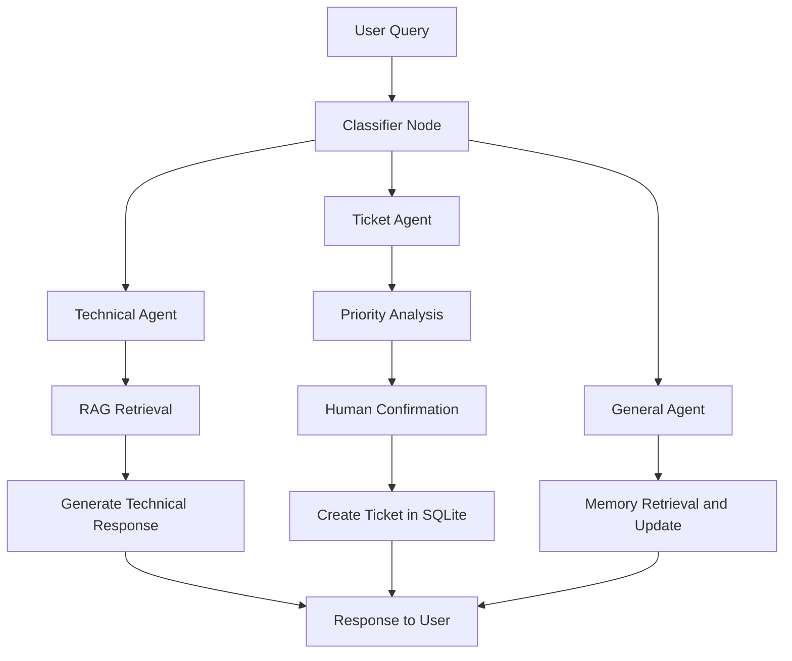

# AI IT Helpdesk Agent

An AI-powered IT Helpdesk Agent built using **Python, LangGraph, LangChain, ChromaDB, SQLite, Ollama, and Streamlit**.

The project automates common IT support tasks through an agent-based workflow, Retrieval-Augmented Generation (RAG), ticket management tools, persistent memory, and Human-in-the-Loop (HITL) confirmation.

## Problem Statement

IT helpdesks receive large volumes of repetitive support requests, including Wi-Fi connectivity issues, printer problems, account lockouts, and hardware failures.

Manual troubleshooting and ticket creation can increase response times and repetitive work.

## Solution

The AI IT Helpdesk Agent acts as a virtual IT support assistant. It uses a LangGraph StateGraph to classify and route user requests.

- **Technical Queries:** Uses RAG to retrieve relevant information from IT troubleshooting documents.
- **Ticket Requests:** Analyzes issue priority and requests user confirmation before creating a support ticket in SQLite.
- **General Queries:** Stores and retrieves user information using persistent memory.

## System Architecture and Workflow

### LangGraph Workflow



### RAG Pipeline

1. **Document Loading:** Loads IT troubleshooting documents from the `knowledge_base/` directory.
2. **Text Chunking:** Uses RecursiveCharacterTextSplitter to split documents into overlapping chunks.
3. **Embeddings:** Uses the `all-MiniLM-L6-v2` sentence-transformer model to generate vector embeddings.
4. **Vector Storage:** Stores embeddings locally using ChromaDB.
5. **Contextual Generation:** Uses Ollama with the `llama3.2` model to generate responses based on retrieved information.

## Features

- **Local AI Processing:** Uses Ollama, ChromaDB, Hugging Face embeddings, SQLite, and Streamlit without requiring paid LLM API keys.
- **Ollama Health Monitoring:** Displays the availability status of Ollama and the configured model.
- **Human-in-the-Loop Confirmation:** Requires user confirmation before creating support tickets.
- **Priority Detection:** Classifies support issues as HIGH, MEDIUM, or LOW priority.
- **Persistent Memory:** Stores user information in SQLite across application sessions.
- **Ticket Management:** Supports ticket creation and ticket status lookup.
- **RAG-Based Troubleshooting:** Retrieves relevant information from the IT knowledge base.

## Technology Stack

| Component | Technology |
|---|---|
| Programming Language | Python |
| Frontend | Streamlit |
| Agent Orchestration | LangGraph |
| AI Framework | LangChain |
| LLM | Ollama - llama3.2 |
| Embeddings | Hugging Face Sentence Transformers |
| Vector Database | ChromaDB |
| Relational Database | SQLite |
| Data Analysis | Pandas |
| Data Visualization | Plotly |

## Project Structure

```text
AI-it-helpdesk-agent/
|
|-- app.py
|-- dashboard.py
|-- requirements.txt
|-- README.md
|
|-- pages/
|   |-- 2_Ticket_Analytics.py
|
|-- src/
|   |-- __init__.py
|   |-- config.py
|   |-- database.py
|   |-- memory.py
|   |-- tools.py
|   |-- rag.py
|   |-- agents.py
|   |-- graph.py
|
|-- knowledge_base/
|   |-- wifi.txt
|   |-- internet.txt
|   |-- printer.txt
|   |-- software.txt
|   |-- password.txt
|   |-- vpn.txt
|   |-- email.txt
|   |-- slow_laptop.txt
|
|-- tests/
|   |-- test_helpdesk.py
|   |-- full_checklist_verification.py
|   |-- run_and_check_all_features.py
|
|-- data/
    |-- .gitkeep
```

## Installation and Setup

### 1. Clone the Repository

```bash
git clone https://github.com/naseemashaik9949-debug/AI-it-helpdesk-agent.git
cd AI-it-helpdesk-agent
```

### 2. Install Dependencies

```bash
pip install -r requirements.txt
```

### 3. Install and Configure Ollama

Install Ollama from:

https://ollama.com

Pull the required model:

```bash
ollama pull llama3.2
```

### 4. Run the Application

Start the Streamlit application:

```bash
streamlit run app.py
```

The application will open in your browser.

## Verified Demo Scenarios

| Scenario | Input Query | Expected Outcome |
|---|---|---|
| Wi-Fi Troubleshooting | My Wi-Fi is not connecting | Retrieves troubleshooting guidance using RAG |
| Slow Laptop | My laptop is very slow | Retrieves relevant troubleshooting instructions |
| Ticket Creation | Create a ticket for my laptop issue | Analyzes priority and requests confirmation |
| Ticket Lookup | Check my ticket status | Retrieves ticket information from SQLite |
| Persistent Memory | My name is Throna | Stores and retrieves user information |

---

## Additional Enhancement: IT Support Analytics Dashboard

I extended the original AI IT Helpdesk Agent by developing and integrating a separate IT Support Analytics Dashboard.

### Dashboard Features

- **KPI Metrics:** Displays total tickets, open tickets, closed tickets, and closure rate.
- **Priority Analysis:** Visualizes ticket distribution by HIGH, MEDIUM, and LOW priority.
- **Status Analysis:** Compares open and closed tickets.
- **Issue Categorization:** Classifies ticket descriptions into Network, Hardware, Account Access, Software, Printer, and Other categories.
- **Ticket Trends:** Analyzes daily ticket creation patterns.
- **Interactive Filters:** Filters ticket records by priority and status.
- **CSV Export:** Allows filtered ticket records to be downloaded for further analysis.

### Implementation

- Connected the dashboard to the existing SQLite ticket database.
- Used Pandas for data preparation and analysis.
- Used Plotly for interactive charts and visualizations.
- Integrated the dashboard as a separate page in the Streamlit application.
- Preserved the original chatbot and ticket management functionality.

**Note:** Issue categories are inferred from ticket descriptions using keyword-based rules. They are not stored as categories in the original database.

### Manual Testing Results

| Test | Result |
|---|---|
| SQLite ticket retrieval | Passed |
| KPI calculation | Passed |
| Priority and status charts | Displayed |
| Issue category analysis | Displayed |
| Daily ticket trend | Displayed |
| Ticket record display | Passed |
| CSV report download | Passed |
| Streamlit multipage navigation | Passed |

### Technologies Used for the Enhancement

Python, Streamlit, Pandas, Plotly, SQLite.

---

## Future Improvements

- Integrate Active Directory or LDAP authentication.
- Add automated email notifications for ticket creation.
- Support screenshot-based troubleshooting using vision models.
- Expand analytics with additional ticket performance metrics.

## Project Attribution

This repository is a fork of the original AI IT Helpdesk Agent project by its original author(s).

The original implementation and its authors retain their respective credit.

My contribution includes developing and integrating the IT Support Analytics Dashboard, updating project documentation, and adding the required dependencies.

